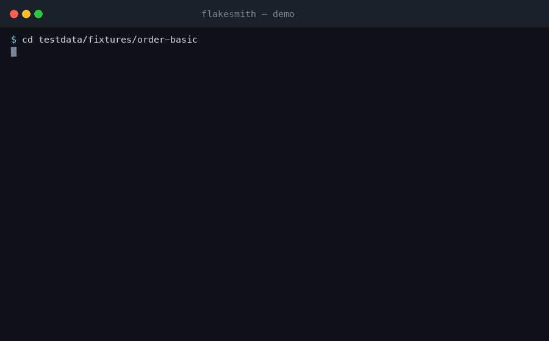

# flakesmith

[](https://github.com/emrelab/flakesmith/actions/workflows/ci.yml)
[](https://github.com/emrelab/flakesmith/actions/workflows/nightly.yml)
[](https://pkg.go.dev/github.com/emrelab/flakesmith)
[](https://goreportcard.com/report/github.com/emrelab/flakesmith)
[](LICENSE)

> Reproduce the flake in 30 seconds instead of 30 minutes — and leave a permanent regression test in the repo.

Finds flaky Go-test failures caused by **order, parallelism, repetition and
environment**, shrinks them to the smallest witness (polluter → victim) and
generates a regression test you can commit.

It does *not* detect flaky tests — that layer is crowded (BuildPulse, Trunk,
`gotestsum --rerun-fails`). This tool does **reproduction** and
**permanence**: it turns a failing behavior into a test file that never gets lost again.

```
go test -json  →  hypothesis order  →  ddmin  →  capsule  →  regression test
                  repeat             smallest
                  order              polluter→victim
                  parallel
                  env
```



Changing the order requires a temporary witness file, because in Go
`go test -run '^(TestA|TestB)$'` runs in **source order** — the regex order
changes nothing (verified, Go 1.26.2). Zero external dependencies: one binary,
stdlib only.

## Install

Prebuilt static binaries ship with every [release](https://github.com/emrelab/flakesmith/releases):
linux and darwin (amd64/arm64), windows (amd64), each published with a
`SHA256SUMS` file. No release has been cut yet, so `go install` is the path that
works today: `go install
github.com/emrelab/flakesmith/cmd/flakesmith@latest` — and it is also the
fallback the GitHub Action uses when no prebuilt binary fits its ref.

## First 5 minutes

```sh
go install github.com/emrelab/flakesmith/cmd/flakesmith@latest

# 1) scan every package (default: 1000 runs / 5 min budget)
cd ~/projects/service
flakesmith hunt ./...

# 2) turn the found flake into a permanent test file
flakesmith compile
go test -tags flakesmith -run '^TestFlakeRegression_' .

# 3) send the capsule to your team (runs no tests, needs no `go`)
flakesmith explain .flakesmith/fs_*.json --format markdown
```

Real output (`testdata/fixtures/order-basic`):

```
flake found: TestVictim
  package      : fixture/orderbasic
  class        : order
  polluter     : TestPolluter
  run          : 3/3 failed
  deterministic: yes
  evidence     : TestPolluter writes, TestVictim reads: seeded

  reproduce:
    go test . -run '^TestFlakeWitness$' -count=1 -parallel=1

  capsule      : fs_e3c71933f905
  status       : confirmed
```

The generated regression test (`compile`):

```go
//go:build flakesmith

// Code generated by flakesmith; DO NOT EDIT.
func TestFlakeRegression_TestVictim(t *testing.T) {
	t.Run("polluter/TestPolluter", TestPolluter)
	t.Run("victim/TestVictim", TestVictim)
}
```

The price of the build tag: `go test ./...` does not see it. In exchange the
default suite neither slows down nor turns red. The test **will be red** right
now — the artifact's job is to catch the flake, not to fix it. After the fix it
turns green and guards the regression permanently.

## Scanned real repos (beyond our own fixtures)

What a flake hunter should say about a healthy codebase is *nothing* — so the
first real-world metric is **false positives**, not witnesses:

| Repo | Scan | Result |
|---|---|---|
| `sirupsen/logrus` | root package | 0 flakes; run budget hit → self-reported `partial` capsule |
| `rs/zerolog` | root package | 0 flakes; budget-capped, honest `partial` |
| `spf13/viper` | root package | 0 flakes; budget-capped, honest `partial` |
| `fatih/color` | root package | 0 flakes; budget-capped, honest `partial` |
| `mattn/go-colorable` | root package | clean full scan, 0 flakes |
| `urfave/cli` v3 | root package | 0 flakes; budget-capped, honest `partial` |
| `google/trillian` @ pre-[#2792] | `./log` | clean full scan, 0 flakes — see note |

[#2792]: https://github.com/google/trillian/pull/2792

**The trillian note:** we checked out the parent of the commit that fixed
their order-dependent test and hunted `./log` there. The suite passed clean on
our machine — their pollution needed a wider run context than the package
replay produces. Reported as-is; no witness claimed.

Across all seven scans: **zero findings, so zero false findings.** We state it
that way on purpose — seven scans that emitted nothing do not measure a false
positive *rate*; they only show the hunter stayed quiet on healthy code. Every
witness flakesmith does emit must deterministically replay (that is the
contract the capsule carries), and a rate will be quoted only once real
witnesses exist.
Hunting ≥2 confirmed real-world `polluter→victim` pairs is the tracked next
milestone ([#1](https://github.com/emrelab/flakesmith/issues/1)) — this table will only
ever list scans that actually ran.

## Commands

| Command | What it does | Runs tests? |
|---|---|---|
| `hunt <pkg...>` | scans packages, classifies, writes capsules | ✅ |
| `repro <pkg> [Test]` | shrinks one known suspect (the budget goes to a single test); `--from-json FILE\|-` takes a failed `go test -json` log instead of typing suspects | ✅ |
| `compile [id] [--verify]` | generates a permanent regression test from a capsule; `--verify` runs the artifact once | with `--verify` |
| `replay [id]` | runs the witness N times, verifies determinism | ✅ |
| `explain [id]` | renders a capsule as a text/JSON/markdown report | ❌ |
| `init [dir]` | writes a `.github/workflows/flakesmith.yml` scaffold | ❌ |

Shared flags: `--format text|json|markdown|sarif` · `--budget N` · `--timeout 10m` ·
`--seeds N` · `--repeat N` · `--capsule-dir DIR` · `--fail-on-flake` · `--race`
· `-v` · `--debug` (internal error detail) · `--short` (scan with `-short`:
the target's own short-skipping tests do not spend the budget). `hunt` also
takes `--changed` ·
`--base REF` · `--baseline FILE` · `--write-baseline` · `--polluter-pkg PKG`
(cross-binary suspect, see below) · `--sarif FILE` (write SARIF 2.1.0 alongside
any format — one hunt feeds both the job summary and code scanning). `compile`
also takes `--pkg DIR`, `--print`, `--dry-run` and `--verify`.

`compile --verify` keeps three verdicts apart — `verified` (the red reproduced),
`green-not-reproduced` and `skipped-missing-env` — records the one it got in
the capsule's `verifyStatus`, and exits 3 unless the artifact actually turned
red. A skipped run is never a green verification.

`--race` never narrows the search: the witness is found without race, then
verified once with `-race`. If it does not reproduce, the capsule's `"race"`
field stays `false` and the report adds a "not reproduced under a race run"
note — evidence is never invented.

`--format json` produces **a single document** (`flakes: []` on a clean run):

```json
{ "schema": "flakesmith/v1", "flakes": [ { "id": "fs_…", "kind": "order", … } ],
  "runs": 42, "maxRuns": 1000 }
```

## Exit codes

CI scripts bind to these; no path fails silently with 0.

| Code | Meaning |
|---|---|
| `0` | clean scan (`hunt`), or a flake was found (gate off) |
| `1` | flake found (`--fail-on-flake`) |
| `2` | usage error |
| `3` | `repro`: the requested test did not reproduce within budget; `compile --verify`: the artifact stayed green **or was skipped for a missing env var** |
| `4` | budget exceeded (partial capsule written) |
| `5` | unsupported form (pollution that no single-binary witness can express — e.g. an in-memory global across two test binaries) |
| `6` | package does not build |
| `10` | internal error (detail with `--debug`) |
| `130` | cancelled (SIGINT); half-written witness files deleted |

## What it can and cannot find

| Class | Status | Witness |
|---|---|---|
| `repeat` — repeats in the same process | ✅ | `-count=N` |
| `order` — another test runs first | ✅ | polluter→victim chain, shrunk with ddmin |
| `parallel` — only when concurrent | ✅ | witness with `t.Parallel()` on every step + `-parallel=N` |
| `env` — depends on an env var | ✅ | the key is stored in the capsule, **never the value** |
| subtests (`t.Run` tree) | ✅ | the parent test is called; verdicts fold onto subtests |
| `TestMain` | ✅ | the witness is installed in the same package, `TestMain` runs too |
| pollution across two test packages | ⚠️ `--polluter-pkg` | only state that **survives the process boundary** (files, ports): hunt names the two-stage command `go test <polluter> && go test <victim>`, `replay` runs both stages. In-memory globals cannot cross two binaries — no witness is claimed. `compile` refuses these honestly (exit 5) and prints the runnable command |
| time/network/DB dependent | ❌ | outside environment control — with one naming exception: a `testing/synctest` bubble has a **virtual clock**, the scan names its users, and a flagged test whose verdict still varies is a real code bug, not environment |

Every boundary is **honest**: instead of saying "no flake" in an out-of-scope
class, it names the class it cannot see.

## GitHub Actions

```yaml
- uses: emrelab/flakesmith@main   # pin a v* release tag once one is published
  with:
    paths: ./...
    format: markdown
    budget: "200"
    # fail-on-flake: "true"   # if you want the gate
```

**Budget defaults differ by surface, on purpose.** Local `hunt` starts at 1000
runs / 5m — a laptop can afford the coverage of `./...`; the Action and the
`flakesmith init` scaffold start at 200 runs / 10m, because a shared runner's
wall clock is the scarce resource and ten minutes is what a job can spend on one
hunt before it looks hung. Pass `budget:`/`--budget` and `timeout:`/`--timeout`
when you want the same shape on both.

The action prefers the prebuilt binary of its own tag (verified against
`SHA256SUMS`) and falls back to building its own source from
`GITHUB_ACTION_PATH`: pinning a release tag is what says which version is
running, with no waiting on the proxy. No `v*` release has been cut yet — the
only tag is `v0.1.0`, which predates `release.yml` — so the example above pins
`main`, the one ref that is both current and real. Go 1.24+ is required
(`actions/setup-go` is on you).

Turn an already-red `go test` log into a PR comment — `repro --from-json` shrinks
the log's own failures to a witness, no re-scan: [`docs/CI-REPRO.md`](docs/CI-REPRO.md).

`flakesmith init` writes this file into your repo (it never overwrites an
existing one). The default is soft mode: a newly adopted flake hunter that
turns CI red on day one gets removed on day two.

## Design

- **The witness is evidence, not a fix:** the generated test does not fix the
  flake, it reproduces it. It turns green after the fix.
- **Noise-free:** the witness file gets a `zz_` prefix (Go skips `_`/`.`
  prefixed files) and is deleted after the run; `compile` output is build-tagged.
- **Budgeted:** every run counts, cancellation works; an interrupted run is
  never read as "passed".
- **Leak-proof:** the env key is stored, the value is not.

Full design: [docs/ARCHITECTURE.md](docs/ARCHITECTURE.md).

## Development

```sh
make test    # go test -race ./...
make build   # ./flakesmith
make fmt     # gofmt
```

Every module under `testdata/fixtures` demonstrates a single flake class;
adding a new class is the easiest entry point. See [CONTRIBUTING.md](CONTRIBUTING.md).

CI dogfoods the tool on its own repo: the `self-hunt` job runs `flakesmith
hunt` against flakesmith's packages, so a leaked witness file or a global
state leak turns our CI red before it could embarrass a user.

## License

Apache-2.0 — [LICENSE](LICENSE).
